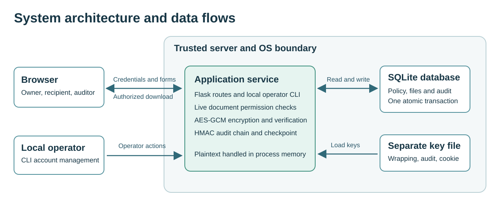

# Part 5 — Technical design

The Secure Document Management System is a CS3002 prototype for storing documents in encrypted form, enforcing current per-document access, and providing an authenticated record of sensitive operations.

## 1. System architecture

1. A browser submits credentials, document forms, and session cookies to Flask. The demonstration uses loopback HTTP. Deployments outside loopback need HTTPS and Secure cookies.
2. Flask verifies the scrypt password hash or the active server-side session. For document operations it resolves ownership or a current grant inside a SQLite transaction. POST forms also require a session-bound CSRF token.
3. A valid upload is held in request memory. PyCA cryptography encrypts the bytes and wraps the data key before storage. On authorized retrieval, the server authenticates the wrapped key and ciphertext before returning an attachment.
4. SQLite stores policy, payloads, and the authenticated audit chain. A separate key file supplies the wrapping key, audit key, and cookie signing secret. The operator performs account maintenance through the CLI, while web administrators review the audit trail.

## 2. Threat model

### Assets

Confidential document bytes, filenames and collaboration metadata, account passwords and hashes, active sessions, ownership and grants, the wrapping and audit keys, and the investigation record.

### Trust boundaries

- **Browser to application.** Client requests, file bytes, identifiers, and form fields are untrusted. The server verifies session and policy and performs the cryptography. Downloaded copies cross into recipient custody.
- **Application to SQLite.** The service account controls runtime database access. For database-only disclosure, keys remain outside SQLite. A party who can write directly to SQLite can disrupt service and change policy state.
- **Application to key file and operator.** The application process and deployment operator are trusted to read the key file or manage accounts. They require OS protection and separately secured key backups. The web audit role has no filesystem or operator access by virtue of that role.

| Threat | Asset and boundary | Implemented control | Residual risk |
|---|---|---|---|
| Password guessing or theft | Account and web boundary | Salted scrypt, per-peer login throttling, generic failures, account disable and session removal | Password phishing, distributed attempts, shared-IP throttling |
| Session misuse or cross-site request | Session and web boundary | Signed HttpOnly/SameSite cookies, Secure cookies under HTTPS, server-side 8-hour expiry, CSRF tokens, session revocation | A stolen still-valid browser session can inherit account permissions |
| Out-of-scope identifier or role | Document and web boundary | Current owner/grant checks in protected route; generic 404 for unavailable documents and 403 for insufficient visible role | New endpoints need the same authorization checks |
| Database disclosure | Stored files and metadata | AES-256-GCM envelope encryption, separate wrapping key, no plaintext document writes | Names, lengths, accounts, grants, and audit metadata remain visible |
| Payload corruption or substitution | Document integrity at storage boundary | GCM tags bind content and key to document ID, owner, filename and purpose; fail closed | Deletion and complete rollback to an older authentic version remain possible |
| Access after revocation | Document and recipient endpoint | Live grants with explicit expiry and revocation; attachment with no-store | Existing copies and already-authorized transfers remain |
| Audit editing, deletion or rollback | Investigation evidence and storage boundary | HMAC-chained events, authenticated checkpoint, append tail checks, full review verification | A matching full database rollback requires an independent checkpoint to detect |
| Exhaustion or service compromise | Availability, keys and data | 5 MiB file cap, form limits, loopback demo, OS access controls as deployment requirement | Serialized writes, resource contention, and compromise of a trusted process |

## 3. Database and storage design

| Table | Data | Purpose |
|---|---|---|
| users | Numeric ID, username, salted password hash, member/admin role, active state | Identity and account lifecycle |
| sessions | SHA-256 of random token, account ID, expiry | Server-side authentication and revocation |
| documents | UUID, owner ID, sanitized filename, update time | Document identity, ownership and listing |
| payloads | Document UUID, two nonces, wrapped data key, ciphertext and GCM tag | Encrypted document material |
| grants | Document ID and recipient ID, viewer/editor role, optional expiry | Named per-document sharing |
| audit | Sequence, UTC time, actor, action, document ID, outcome, detail, MAC | Ordered investigation records |
| audit_head | Expected tail sequence and MAC, with an authentication MAC | Detects tail removal or checkpoint modification |

The default database is `instance/vault.sqlite3`. Document metadata and ciphertext occupy separate tables in the same database so changes and audit events commit together. Foreign keys cascade document deletion to the payload and grants. The audit history can retain the document identifier for investigation. Backups can retain older data. The key file defaults to `.sdms-keys.json` and can be moved through `SDMS_KEY_FILE`. Confidential file content is kept in memory before encryption and after authorized decryption.

## 4. Cryptographic design

- **Document encryption.** PyCA AES-256-GCM encrypts each upload or replacement with a fresh random data key and a 96-bit nonce. AES-256-GCM under a separate service key wraps that data key, using an independent 96-bit nonce. Associated data includes a versioned purpose, document UUID, owner ID, and sanitized filename. Tag failures yield HTTP 409 with no document bytes.
- **Credentials and sessions.** Werkzeug uses salted scrypt with N=65536, r=8, p=1. Sign-in creates a random 256-bit session token. SQLite stores its SHA-256 digest. Flask signs the browser cookie with a dedicated key.
- **Audit.** HMAC-SHA-256 authenticates each serialized event and the preceding MAC. A domain-separated HMAC authenticates the chain head. Events and state changes share a transaction. Full review verifies the entire chain before showing the most recent 100 records.
- **Key lifecycle.** Initialization generates separate 256-bit wrapping, audit, and cookie keys. Operators protect and back up the key file separately from SQLite. Live rotation would require a controlled migration and retained audit verification evidence. Replacing a compromised wrapping key alone cannot protect old stolen ciphertext if its corresponding key was exposed. A lost wrapping key requires restoration from backup.
- **Trust assumptions.** The server and deployment operator can handle plaintext and key material. Captured database files alone do not carry the wrapping key. Stronger isolation would require external key management or a client-side design and a different sharing/recovery model. [PyCA AEAD](https://cryptography.io/en/stable/hazmat/primitives/aead/) · [Werkzeug utilities](https://werkzeug.palletsprojects.com/en/stable/utils/) · [Python HMAC](https://docs.python.org/3/library/hmac.html)

## 5. Access-control design

| Operation | Owner | Editor | Viewer | Signed-in user without a grant |
|---|---|---|---|---|
| Upload and own a new document | Yes | Yes | Yes | Yes |
| List, inspect, verify or download this document | Yes | Yes | Yes | No |
| Replace this document | Yes | Yes | No | No |
| List or change this document’s grants | Yes | No | No | No |
| Delete this document | Yes | No | No | No |

Admin is a separate account role that permits audit review. An admin accesses an existing document through ownership or an ordinary grant. Account provisioning, password reset and enable/disable are local operator actions. For protected routes the server checks the session, account state and operation-specific permission independently of the interface. Grant expiry or revocation denies new requests after it takes effect. Existing downloaded copies remain with the recipient.

## 6. Security testing

The [security testing report](part3-security-tests.md) records all seven required cases, steps, expected and observed behavior, limitations, and mitigation options. [Captured test output](part3-test-output.txt) includes all 11 passing checks, including audit rollback and all seven required scenarios. Tests use synthetic data, temporary keys, and isolated SQLite databases.

## 7. Design decision records

The [design decision record](part4-design-decisions.md) covers storage, cryptography and keys, authorization, sharing and revocation, and audit integrity. [Part 1 research](part1-research.md) documents the alternatives and underlying rationale.

## 8. Repository and evidence

The [GitHub repository](https://github.com/moosarehan/secure-document-management-system) contains application and test source, setup instructions, a synthetic demo document, and screenshots.

## 9. Demonstration

The [demonstration guide](demo.md) covers the live walkthrough and selected controlled security tests. It links to screenshots from the running prototype.
